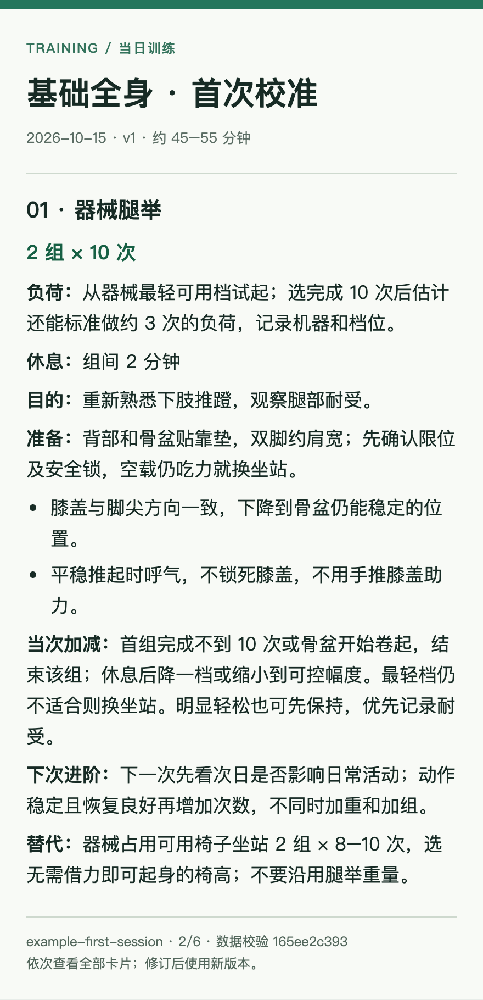

# 自适应训练教练 · Adaptive Training Coach

面向 Codex 的中文训练 Skill：**有阶段主线，每次只出下一练，根据实际反馈调整，定期复盘。**

支持肌肉增长、力量提升、减脂与体成分、心肺耐力、综合体能、健康与习惯。刚开始训练、恢复训练、有训练历史的人都可使用；目标不明确时先引导选择或安排体验。

## 安装到 Codex

把下面这段话直接发给 Codex：

> 使用 $skill-installer 安装 https://github.com/zpygo1/adaptive-training-coach/tree/main/skills/adaptive-training-coach 。不要覆盖已有同名技能或个人训练记录。安装后使用 $adaptive-training-coach 开始建档。

也可下载仓库，将 `skills/adaptive-training-coach` 整个文件夹放入 Codex 的用户级技能目录。[Codex 官方技能说明](https://developers.openai.com/codex/skills/)列出的用户目录是 `~/.agents/skills/`；安装器可能沿用已配置的目录，以实际环境为准。显式调用 `$adaptive-training-coach`，若未被发现则重启 Codex 并让其检查发现路径，不用复制到多个目录造成重复。

## 开始用

```text
使用 $adaptive-training-coach，我想开始训练，但还不知道目标怎么选。
```

```text
使用 $adaptive-training-coach，我一直按部位练力量，每周时间不固定，想改善体成分。
```

训练后直接说实际完成情况，例如：“练完了，腿举三组分别做了10、10、8次，最后一组动作有点不稳。”下次可直接说“安排下一练”。用户无需按模板填表。

## 一次计划会给你什么

- 阶段重点和今天为什么这样练。
- 热身、准备组、正式组、负荷或试重方法、休息及动作说明。
- 太轻、太重、掉次数时怎么调整，何时进阶。
- 器械占用、时间不足、不适时怎么办。
- 练完需要反馈的少量信息。
- 可选手机训练卡：本地 HTML 排版后导出 PNG，保留动作提示与调整规则。

基础对话及 Markdown/HTML 导出不依赖手表、外部账号或付费 API。PNG 导出需 Python Playwright 和 Chromium，安装方式见 [手机卡说明](skills/adaptive-training-coach/references/mobile-card.md)。

## 手机卡预览

这是虚构示例中的一张动作卡；完整示例、文字和分卡文件在 [examples/mobile-card](examples/mobile-card/)。



## 记录与隐私

个人档案、阶段安排、实际训练与复盘写在独立私人目录，不写入 Skill 包。默认不上传、不发送消息、不云同步。升级 Skill 时保留个人数据。无法保存文件的环境会给出交接记录，不能跨会话自动记住一切。

仓库中只有虚构演示，不能直接当个人处方。适用普通成年人训练规划；不替代诊断、伤后康复或专项竞技指导。

## 开发与验证

Python 3.10+：

```bash
python3 -m unittest discover -s tests -v
python3 skills/adaptive-training-coach/scripts/render_plan.py --input skills/adaptive-training-coach/assets/sample-plan.json --output-dir /tmp/training-demo
```

验收说明见 [docs/validation.md](docs/validation.md)。方法依据见 [evidence.md](skills/adaptive-training-coach/references/evidence.md)。

版本：0.1.0。MIT 许可。当前为首版，脚本测试与示例导出已经验证，仍需通过真实训练反馈持续校准。
